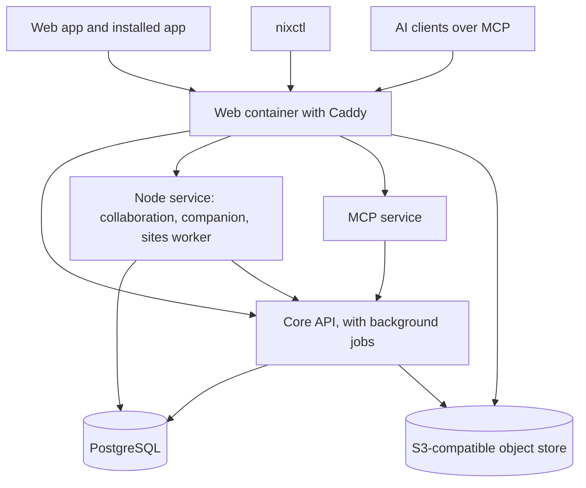

# Deployment

# Deployment

Nix is designed to run on hardware you control. One command installs it on a machine with Docker, or into a Kubernetes cluster: see [Install in one line](nix://item/01a16030-a2fa-76fd-bef3-cb99a1a146d0). Both paths run the same container images, which CI builds for every commit on `main` and publishes to the GitHub Container Registry for `linux/amd64` and `linux/arm64`:

- **Docker Compose** on one machine. This is the default target, with a one-command release script that backs up, migrates and smoke-tests.
- **Kubernetes**, with the sites services included. The manifests default to a small k3s cluster behind Cloudflare and take a few settings for any other cluster.

Start with the architecture, then pick a path.

## How the pieces fit

- **Core** (ASP.NET Core) is the only permission authority. It owns items, properties, views and sign-in, and it runs the background jobs: imports, exports, calendar sync, push delivery and indexing.
- **The Node service** runs collaboration, the pet companion and, when Sites is enabled, the sites worker, as roles of one process. Collaboration stores document edits and history, and assembles imports and exports.
- **The MCP service** serves remote MCP at `/mcp` for AI clients. Every request carries its own token, and Core authorises each call. The installer always runs it, and Kubernetes runs it unless you turn it off; with Compose by hand it is optional.
- **PostgreSQL** holds all durable state, with row-level security, and runs full-text search.
- **The object store** holds file bytes. Browsers reach it through short-lived signed links.
- **Sites**, when enabled, adds a separate serving process for published websites.

## Properties

- title: Deployment

