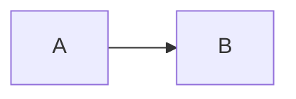

# Plan: Q4 \<draft>

[Linked item](nix://item/00000000-0000-4000-8000-000000000001)

<!-- nix-page-break -->

A paragraph.

## A heading

Before\
after

> Quoted.

```typescript
const answer = 42;
```

---

- First
- Second

  - Nested

1. Step one

- [x] Done
- [ ] Not done

> [!WARNING]
>
> Mind the gap.


| Name | Value |
| --- | --- |
| Answer | 42 |

The wider side.

The other side.

<details data-toggle-level="2">
<summary>Show the details</summary>

Here they are.

</details>

See [The other note](nix://item/0199c0de-0000-7000-8000-000000000001) and ask [Ada](nix://principal/0199c0de-0000-7000-8000-000000000002)

**strong**

*emphasis*

underlined

~~struck~~

`inline()`

highlighted

[a link](https://example.test/page)

coloured by name

somebody had a question about this


struck

restyled

A centered line.



[Linked item](nix://item/00000000-0000-4000-8000-000000000001)

A suggested paragraph.

